# Cherkashyna_nosql_1 — Аналітична платформа для музичного стрімінгового сервісу

Домашнє завдання 1 з курсу «NoSQL and Vector Databases»: завантаження датасету Spotify
у MongoDB Atlas, трансформація у документну схему та аналітичні запити.

## Структура репозиторію

```
Cherkashyna_nosql_1/
├── scripts/
│   ├── 01_load_data.py      # завантаження CSV → колекція tracks_raw
│   └── 02_transform.js      # трансформація tracks_raw → tracks (Aggregation Pipeline)
├── queries/
│   └── part2_queries.js     # частина 2 — чотири запити
├── screenshots/             # скріншоти з Atlas Data Explorer
├── requirements.txt
├── .gitignore               # .env, .venv/, archive/, dataset.csv 
└── README.md
```

## Налаштування оточення

Перевірено на: Windows 11, PowerShell, Python 3.13.17, mongosh 2.14.1, MongoDB Atlas M0 (MongoDB 8.0, AWS Stockholm).

### 1. MongoDB Atlas
1. Створити безкоштовний кластер M0 (без sample dataset — на M0 лише 512 МБ).
2. Database Access — створити користувача з паролем.
3. Network Access — додати `0.0.0.0/0` (для розробки).
4. Connect → Drivers → Python — скопіювати рядок `mongodb+srv://...`.

### 2. Python-оточення
Потрібні Python 3.11+ і [mongosh](https://www.mongodb.com/try/download/shell) (для запуску `.js`-скриптів).

```powershell
git clone https://github.com/owl-solar/Cherkashyna_nosql_1.git
cd Cherkashyna_nosql_1
py -m venv .venv
.venv\Scripts\Activate.ps1
pip install -r requirements.txt
```

### 3. Файл `.env`
Створити в корені проєкту (у репозиторій не комітиться):
```
MONGO_URI=mongodb+srv://<user>:<password>@<cluster>.mongodb.net/
```

### 4. Датасет
Завантажити [Spotify Tracks Dataset](https://www.kaggle.com/datasets/maharshipandya/-spotify-tracks-dataset)
з Kaggle, розпакувати та покласти `dataset.csv` у корінь проєкту (114 000 рядків, 21 колонка).

### 5. Порядок запуску
Усі команди — з кореня проєкту, з активованим `.venv`.

```powershell
# 1. Сирі дані → spotify.tracks_raw
python scripts/01_load_data.py

# 2. Рядок підключення з .env у змінну сесії PowerShell
$env:MONGO_URI = ((Get-Content .env | Select-String '^MONGO_URI=').ToString() -split '=', 2)[1]

# 3. Трансформація → spotify.tracks
mongosh $env:MONGO_URI --file scripts/02_transform.js

# 4. Запити частини 2
mongosh $env:MONGO_URI --file queries/part2_queries.js
```

Очікувані результати:
| Крок | Результат | Час |
|---|---|---|
| `01_load_data.py` | `tracks_raw`: 113 999 документів (1 рядок без виконавця відфільтровано) | ~8 хв 40 с, 114 батчів по 1000 |
| `02_transform.js` | `tracks`: 113 999 документів | < 1 хв (виконується на сервері) |

## Схема даних: колекція `tracks`

Приклад документа після трансформації:

```json
{
  "_id": { "$oid": "6afb701004f2739ef776d724" },
  "track_id": "5SuOikwiRyPMVoIQDJUgSV",
  "album_name": "Comedy",
  "track_name": "Comedy",
  "popularity": 73,
  "duration_ms": 230666,
  "explicit": false,
  "track_genre": "acoustic",
  "artists": ["Gen Hoshino"],
  "audio_features": {
    "danceability": 0.676,
    "energy": 0.461,
    "loudness": -6.746,
    "speechiness": 0.143,
    "acousticness": 0.0322,
    "instrumentalness": 0.00000101,
    "liveness": 0.358,
    "valence": 0.715,
    "tempo": 87.917,
    "key": 1,
    "mode": 0,
    "time_signature": 4
  },
  "duration_sec": 230.7,
  "popularity_tier": "high"
}
```

| Поле | Тип | Звідки |
|---|---|---|
| `track_id`, `track_name`, `album_name`, `track_genre` | string | з CSV |
| `popularity`, `duration_ms` | int | з CSV |
| `explicit` | bool | з CSV, приведено до bool у `01_load_data.py` |
| `artists` | array of string | рядок `"A;B"` розбито через `$split` + `$trim` |
| `audio_features` | вкладений об'єкт | 12 аудіохарактеристик зібрано в один об'єкт |
| `duration_sec` | double | `duration_ms / 1000`, округлено до 1 знака |
| `popularity_tier` | string | `high` (≥ 70), `medium` (40–69), `low` (< 40) через `$switch` |

Примітка: у стадії `$project` стоїть `_id: 0`, але в `tracks` у кожного документа є новий `_id` —
його автоматично згенерувала стадія `$out` під час запису в колекцію. Колонка `Unnamed: 0`
(індекс із CSV) до `tracks` не потрапила, бо її немає в `$project`.

Документ у сирій колекції `tracks_raw` до трансформації (Atlas Data Explorer): поля лежать плоско,
`artists` — рядок, є колонка `Unnamed: 0` з CSV.

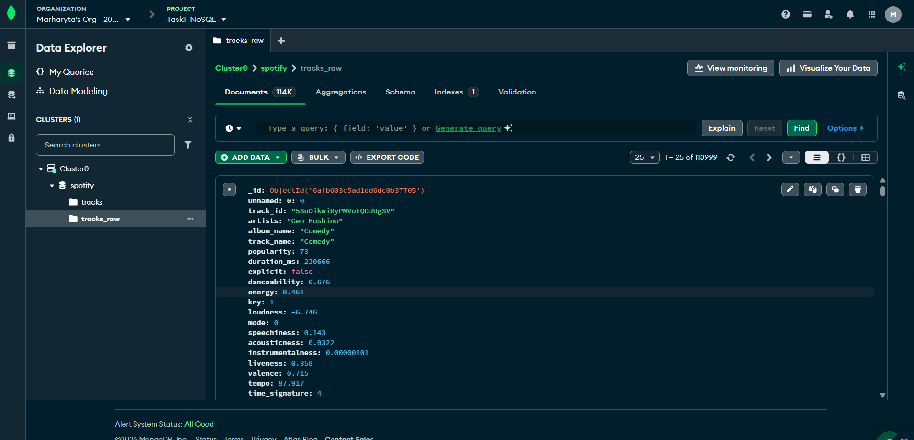

## Частина 1 — теоретичні питання

### 1. Чому аудіохарактеристики винесені в окремий об'єкт `audio_features`? Коли вкладення вигідне, а коли створює проблеми?

Факти з моїх даних:
- `db.tracks.findOne({}, { track_name: 1, audio_features: 1, _id: 0 })` — усі 12 характеристик
  повертаються однією проєкцією, без перелічення кожного поля.
- `db.tracks.countDocuments({ "audio_features.danceability": { $gt: 0.7 } })` → **27 246** треків.
  Запит до вкладеного поля — через крапкову нотацію.

Пояснення:
Я зібрала 12 характеристик звуку в один об'єкт, щоб відділити їх від назви, альбому та жанру. Так
документ легше читати, а всі характеристики можна отримати разом. Вони лежать у тому самому документі,
тому окремий запит чи `$lookup` не потрібен.

Вкладати варто, коли дані належать лише одному документу і зазвичай читаються разом із ним, як тут.
Мінуси: довші шляхи в запитах (`audio_features.tempo`), а для експорту в таблицю об'єкт доводиться
знову «розплющувати».

### 2. Чому виконавці зберігаються як масив, а не як рядок? Які запити стають простішими?

Факти з моїх даних:
- `db.tracks.countDocuments({ "artists.1": { $exists: true } })` → **30 075** треків (~26 % колекції) мають більше одного виконавця.
- `db.tracks.countDocuments({ artists: "Drake" })` → **50** (точний збіг з елементом масиву).
- `db.tracks_raw.countDocuments({ artists: /Drake/ })` → **66** у сирій колекції з рядком.
- Зайві 16 треків — це **Nick Drake** (12) та **Ashley Drake** (4): у їхніх іменах теж є «Drake».

Пояснення:
Якщо виконавці записані одним рядком `"A;B"`, шукати можна лише через regex, а він неточний: `/Drake/`
знаходить ще й Nick Drake та Ashley Drake (66 треків замість 50).

У масиві кожен виконавець це окремий елемент, тому `{ artists: "Drake" }` дає точний збіг. Простіше
стає рахувати виконавців, знаходити колаборації та збирати статистику по кожному виконавцю через
`$unwind`. Без масиву колаборацію «A;B» рахувало б як окремого виконавця.

## Частина 2 — запити

Код усіх чотирьох запитів — у файлі `queries/part2_queries.js`, запуск: `mongosh $env:MONGO_URI --file queries/part2_queries.js`.

Загальна особливість датасету, яка впливає на всі запити: один і той самий трек (`track_id`)
може бути записаний у кількох жанрах (наприклад, «LOKERA» — `latin` і `latino`, «Party» — `latino`, `reggaeton`, `reggae`).
Тому для завдань 1 і 4 виводиться і кількість документів, і кількість унікальних `track_id`.

### Завдання 1. Треки для вечірки

Результат: **7 311** документів, **5 328** унікальних `track_id`. Топ за популярністю:
«Calm Down (with Selena Gomez)» — Rema, Selena Gomez (92), «LOKERA» — Rauw Alejandro, Lyanno, Brray (91),
«Party» — Bad Bunny, Rauw Alejandro (90).

Пояснення:
Це звичайний `find` із трьома умовами, які мають виконуватися одночасно. До вкладених полів звертаюся
через крапку. Межі 3–5 хвилин включаю (`$gte` / `$lte`).

Документів 7 311, а унікальних треків 5 328, бо той самий трек буває записаний у кількох жанрах.

Той самий запит у Atlas Data Explorer (вкладка Documents: Filter, Project, Sort) — 7 311 документів:

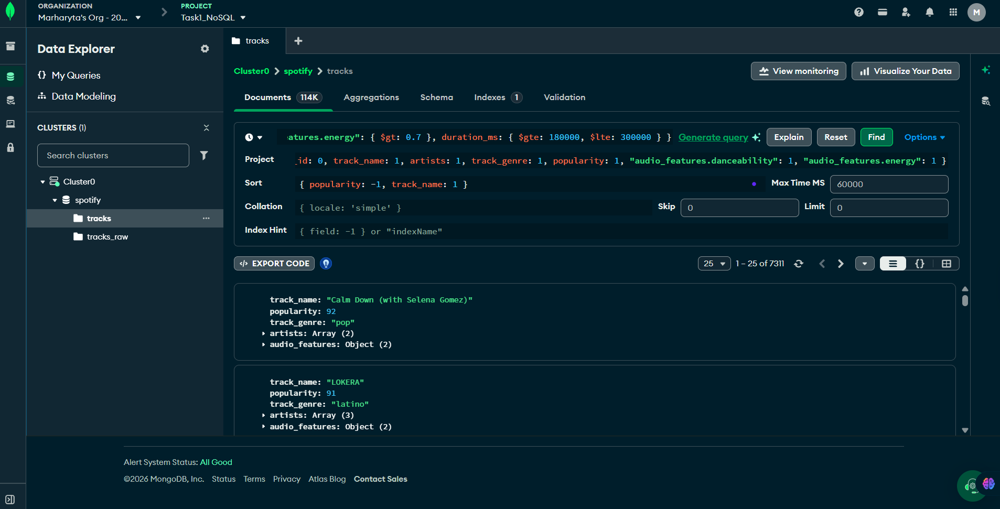

### Завдання 2. Виконавці, у яких усі треки популярні

Результат (топ-5 із 20):

| artist | track_count | min_popularity | avg_popularity |
|---|---|---|---|
| Harry Styles | 3 | 89 | 92 |
| Olivia Rodrigo | 5 | 86 | 87.4 |
| IVE | 3 | 79 | 84 |
| Morgan Wallen | 3 | 81 | 83.3 |
| One Direction | 5 | 80 | 83 |

Пояснення:
`$unwind` розгортає масив, щоб кожен трек зарахувався кожному з його виконавців. Перший `$group`
прибирає дублікати треків, другий рахує для кожного виконавця кількість треків, мінімальну та середню
популярність. `$match` після групування відбирає тих, у кого щонайменше 3 треки і мінімальна
популярність не нижча за 60. Далі сортування, топ-20 і округлення.

Той самий pipeline, зібраний по стадіях у Atlas Data Explorer (вкладка Aggregations).
Прев'ю кожної стадії Atlas рахує на вибірці документів, а не на всій колекції, тому в прев'ю
стадій 5–7 порядок виконавців відрізняється від остаточного. Повний результат — після **Run**.

| Стадія | Скріншот |
|---|---|
| 1. `$unwind` | 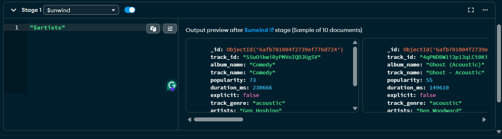 |
| 2. `$group` (виконавець + трек) | 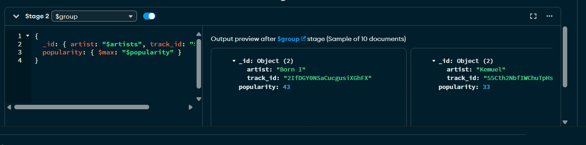 |
| 3. `$group` (агрегати по виконавцю) | 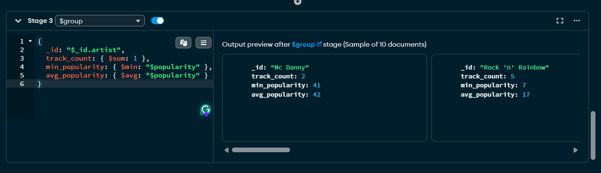 |
| 4. `$match` | 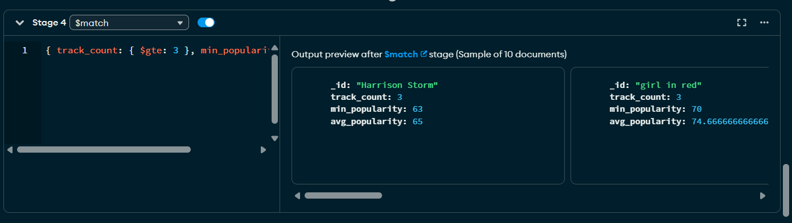 |
| 5. `$sort` | 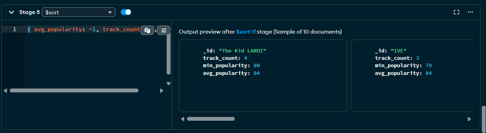 |
| 6. `$limit` | 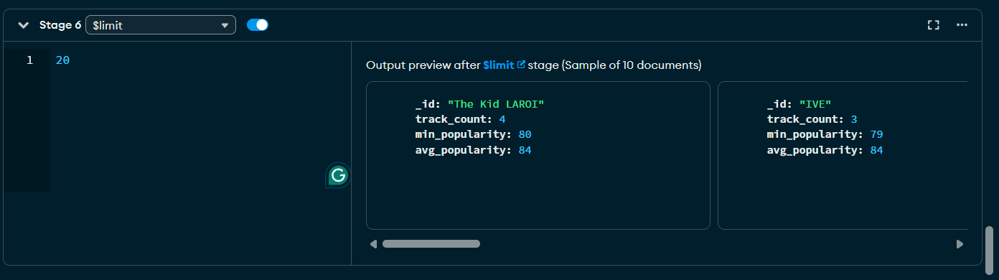 |
| 7. `$project` | 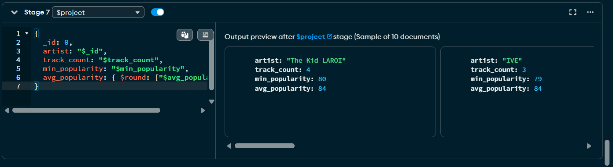 |

Результат **Run** на всій колекції збігається з виводом mongosh:

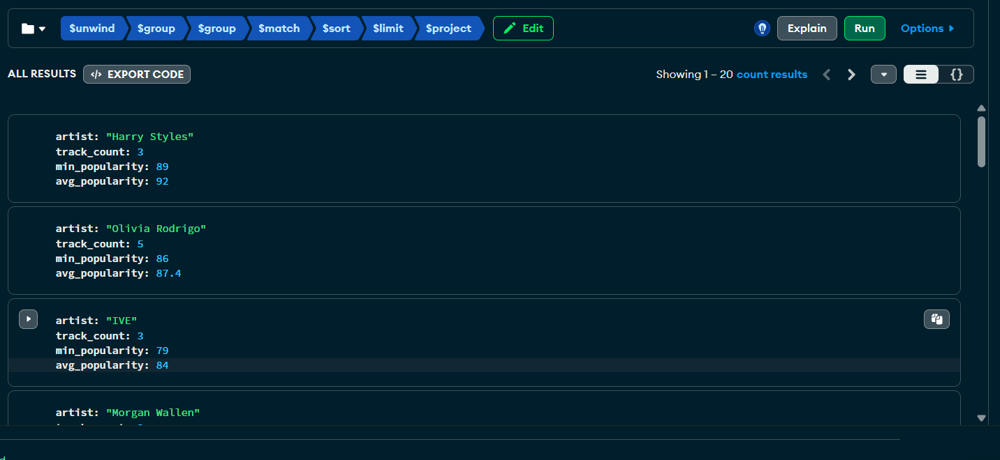

### Завдання 3. Нетипові треки

Результат: **114** жанрів, **3 506** нетипових треків. Для `acoustic`: `avg_tempo` = 119,
`outlier_threshold` = 178.5 — збігається з прикладом у завданні; серед нетипових є
«The Legend of Olog-hai, Pt. 1» (tempo 182.379). Найбільше нетипових треків:

| genre | avg_tempo | outlier_threshold | outlier_count |
|---|---|---|---|
| dancehall | 112.9 | 171.4 | 81 |
| opera | 105.6 | 167.3 | 65 |
| electro | 120.8 | 175.7 | 62 |
| j-dance | 114.9 | 175.1 | 62 |
| edm | 122 | 166.6 | 58 |

Пояснення:
Спочатку для кожного жанру рахую середній темп і стандартне відхилення, а з них — поріг
«середнє + 2 відхилення». Потім `$lookup` знаходить треки цього жанру, швидші за поріг.

Цікаво, що в багатьох «нетипових» треків темп близько 180–205 BPM. Можливо, частина з них насправді
не швидка: темп міг визначитися подвоєним.

Той самий pipeline, зібраний по стадіях у Atlas Data Explorer (вкладка Aggregations):

| Стадія | Скріншот |
|---|---|
| 1. `$group` (avg і stdDevPop по жанру) | 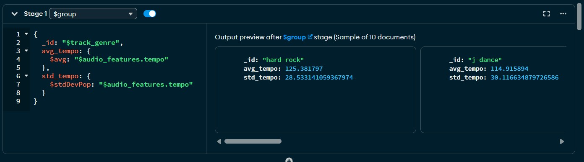 |
| 2. `$addFields` (поріг) | 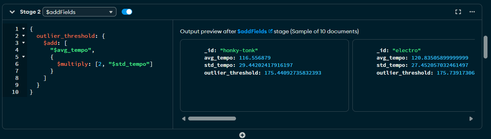 |
| 3. `$lookup` (нетипові треки жанру) | 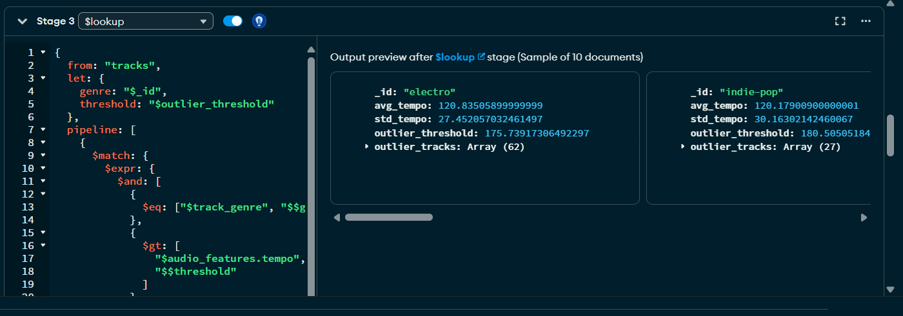 |
| 4. `$project` | 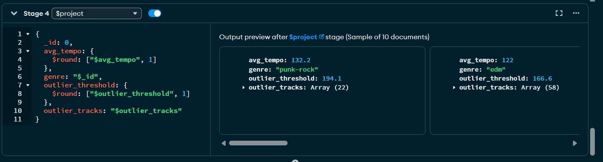 |
| 5. `$sort` | 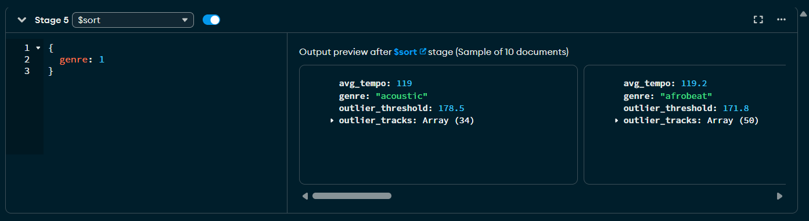 |

Результат **Run**: перший документ — `acoustic` (avg_tempo 119, outlier_threshold 178.5, 34 нетипові треки):

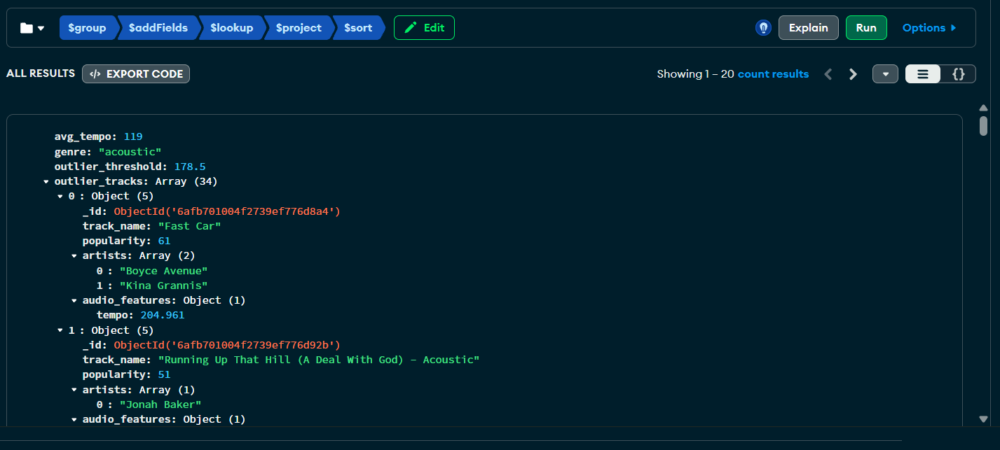

### Завдання 4. Треки для фонової роботи

Результат: **9 324** документи, **8 311** унікальних `track_id`. У топі — жанри `ambient`, `classical`,
`sleep`, `indie`, `indie-pop` (Ludovico Einaudi «Experience», Cigarettes After Sex «K.», White Noise).

Пояснення:
Чотири умови: тихий трек, мало мовлення, переважно інструментальний і без explicit. Фільтр не
ідеальний: на першому місці пісня Billie Eilish з вокалом, яка формально проходить усі пороги.

Той самий запит у Atlas Data Explorer (вкладка Documents: Filter, Project, Sort) — 9 324 документи:

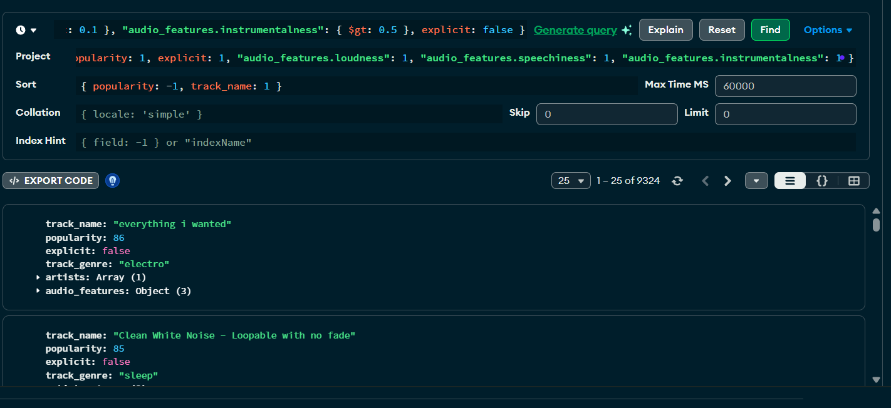

## Висновки

Я завантажила датасет в Atlas, перетворила його на документну схему і виконала чотири запити.

Цікаво, що один трек може бути записаний у кількох жанрах. Через це кількість
документів не збігається з кількістю треків, і в завданні 2 довелося прибирати дублікати. Ще добре
видно, навіщо масив виконавців: пошук по рядку знаходить зайве.

Завантаження з Python тривало майже 9 хвилин, а трансформація на сервері — менше хвилини. Тому важку
обробку краще робити в Aggregation Pipeline.

Наступного разу я зберігала б кожен трек один раз, а жанри — масивом.